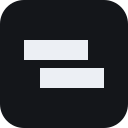

<div align="center">
  
  <h1>CutCap</h1>
  <p><strong>A local-first video editor for Arch Linux, Omarchy, and Hyprland.</strong></p>
  <p>Cut clips on a multi-track timeline, grade the look, add captions and voiceover, export. Everything runs on your machine — no cloud, no account, no telemetry.</p>

  <p>
    
    
    
    
    
    
    
  </p>
</div>

---

CutCap is a desktop video editor shaped around Omarchy and Hyprland. The window tiles like any other: media bin left,
viewer centre, inspector right, timeline across the bottom. It drives local `ffmpeg` / `ffprobe` through `QProcess` —
preview and export use the same filtergraph, so what you see is what you get.

```text
Import media (or drop files / a .cutcap project)
  -> probe + thumbnails + filmstrip + waveform (async, GUI never blocks)
  -> drag clips onto V1 / V2 / A1 lanes, trim, split, group-move
  -> grade each clip: brightness, contrast, saturation, blur, vignette, chroma key (GPU shader)
  -> add transitions at clip junctions (xfade)
  -> auto-captions (local whisper) or TTS voiceover (local piper / espeak)
  -> export with presets and codecs (h264 / h265 / av1)
```

## Features

- **Multi-track timeline:** V1 (base video), V2 (overlay / PiP), A1 (audio). Drag, trim, split, multi-select,
  group drag. Timeline zoom and a draggable split handle. Only the visible viewport renders.
- **Per-clip look grading on the GPU:** brightness / contrast / saturation, box blur, vignette, chroma key —
  applied in a fragment shader, matching the ffmpeg export filter exactly (max per-channel delta 1).
- **Transitions:** click a junction chip between two touching clips on one lane to set an xfade transition.
- **Captions:** auto-generate with local whisper (`whisper-cli` / `faster-whisper`), or type your own.
  Caption ids are unique, they follow trim and speed changes, and typed backslashes are preserved.
- **Voiceover:** record in-app (PipeWire) or generate with local TTS (piper / espeak-ng) and place on A1.
- **Undo / redo** carries previews, filmstrips, and waveforms — nothing is lost on revert.
- **Theme-driven:** follows the live Omarchy theme (`~/.config/omarchy/current/theme/colors.toml`) and Hyprland
  rounding, no restart needed. All visual values come from `DESIGN.md` tokens.
- **Safe by default:** project files may only name absolute local media paths; chroma-key colours are validated
  on load (no filter injection); closing while an export or recording runs asks first.
- **Headless CLI:** probe, create projects, add clips, split, add text, generate captions, and export — all
  scriptable with `--json` output.

## Shortcuts

| Key | Action |
|-----|--------|
| `Space` | Play / pause |
| `Left` / `Right` | Nudge playhead ±0.1 s (or adjust a focused slider) |
| `S` | Split at playhead |
| `Ctrl+B` | Toggle clip at playhead between lanes |
| `Delete` / `Backspace` | Remove selected clips |
| `Ctrl+Z` / `Ctrl+Shift+Z` | Undo / Redo |
| `Ctrl+O` / `Ctrl+S` | Open / Save project |
| `Ctrl+E` | Export |
| `Ctrl+A` | Select all |
| `Escape` | Deselect / close dialog |
| `?` | Shortcuts dialog |
| `Ctrl+Q` | Quit |

## Building & testing

Requires Qt 6.12+, qmake6, ffmpeg, and a C++17 compiler.

```bash
./bin/build     # qmake6 + make into ./build
./bin/test      # 71 QtTest cases, offscreen (QT_QPA_PLATFORM=offscreen)
./bin/install   # build + makepkg -fsi (Arch package, installs to Omarchy menu)
```

`BUILD_DIR=/tmp/cutcap-build ./bin/build` builds out-of-tree without touching `./build`.

## CLI

```bash
cutcap [open <file>]                          # launch GUI
cutcap capabilities [--json]                  # local tools (ffmpeg, whisper, tts, rembg)
cutcap probe <media> [--json]                 # probe media metadata
cutcap new <project.cutcap> [--title T]       # create empty project
cutcap add-clip <project.cutcap> <media>      # add clip to a track
cutcap split <project.cutcap> <clip-id> <at> # split a clip
cutcap add-text <project.cutcap> --text "…"   # add text / caption
cutcap captions <project.cutcap> <media>      # auto-generate captions (whisper)
cutcap export <project.cutcap> <out.mp4>      # export (--preset, --codec)
```

## Architecture

```text
cutcap.pro                  qmake project
bin/build                   qmake6 + make
bin/test                    QtTest runner, offscreen
bin/install                 makepkg -fsi
src/main.cpp                entry point, CLI router, QML engine
src/backend.{h,cpp}         state, undo/redo, import/export jobs (QtConcurrent), QProcess export
src/cliplistmodel.{h,cpp}   QAbstractListModel for the timeline — edits arrive as dataChanged per row
src/mediaengine.{h,cpp}     ffprobe / ffmpeg / whisper / piper / rembg wrappers
src/clipframeitem.{h,cpp}   QQuickItem preview with GPU look shader (src/shaders/look.frag)
src/project.{h,cpp}         .cutcap project model + JSON persistence
src/theme.{h,cpp}           Omarchy theme watcher (colors.toml + hyprctl rounding)
src/design.{h,cpp}          design tokens singleton (DESIGN.md)
src/qml/                    9 QML views: Main, TimelinePanel, PreviewPanel, InspectorPanel, MediaBinPanel, …
tests/cutcap_tests.cpp      71 QtTest cases
```

## Documentation

- [DESIGN.md](DESIGN.md) — the design system: tokens, type scale, spacing, accent budget, enforced by tests
- [HANDOFF.md](HANDOFF.md) — audit history, what was fixed, open work
- [plans/](plans/) — the 15 implementation plans from the last audit round

## License

[MIT](LICENSE)
